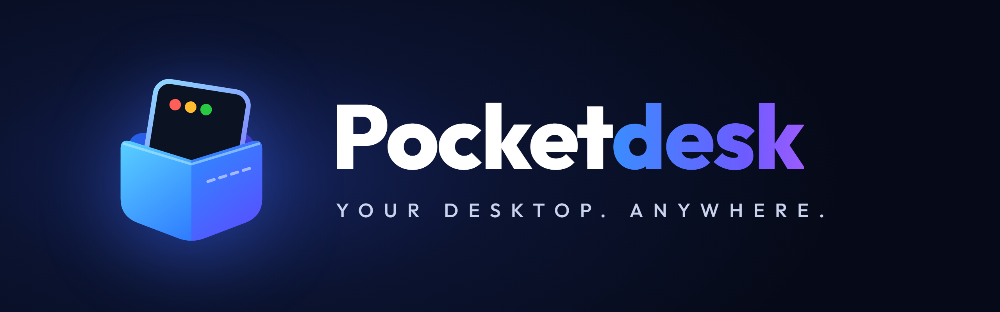
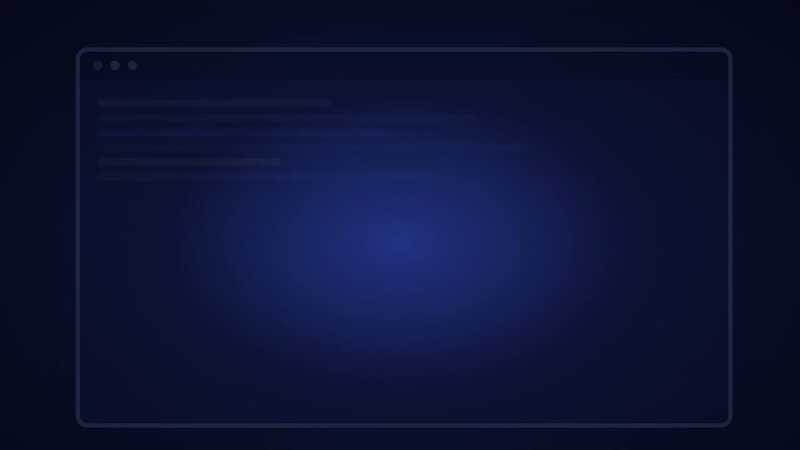

<p align="center">
  
</p>

<h1 align="center">Pocketdesk</h1>

<p align="center"><b>Your Windows or Linux computer, on your Android phone.</b><br>
Its live screen under your fingers, its sound, and the clipboard, files, notifications and texts moving both ways: on your network, through Tailscale, or over the internet with no port forward and no account.</p>

<p align="center">
  <a href="https://www.rust-lang.org/"></a>
  <a href="#license"></a>
  <a href="https://github.com/sreevarshan-xenoz/Pocketdesk/actions"></a>
  <a href="https://github.com/sreevarshan-xenoz/Pocketdesk/issues"></a>
  <a href="#roadmap"></a>
</p>

<p align="center">
  <a href="assets/brand/pocketdesk-launch.mp4"></a><br>
  <sub>▶ <a href="assets/brand/pocketdesk-launch.mp4">Watch it with sound (32 seconds)</a></sub>
</p>

## What is Pocketdesk?

Pocketdesk is a **pure Rust** server for Linux (Wayland-native, Hyprland first) and Windows 10/11, a desktop app to manage it, and a native Android app. Together they give you:

- **Your screen on the phone, at low latency.** wlroots or PipeWire capture on Linux, Windows.Graphics.Capture on Windows, hardware H.264/HEVC encoding, QUIC transport, Android MediaCodec decoding.
- **Control from the phone.** Direct touch, a trackpad with gestures, a pen with pressure for drawing apps, a gamepad, an air mouse, a full keyboard with a modifier and function-key bar, and the desktop's sound on the phone (the phone's mic works the other way).
- **The KDE Connect set, both ways.** The clipboard (text and images), files in both directions and a remote file browser, the phone's notifications, texts and ringing calls on the computer, its battery and state, ringing either one to find it, and waking the computer from the phone.
- **The phone on the computer.** Its screen or its camera in a window, which the mouse and keyboard can drive, with its sound; its recent photos and shared folders; its music in the computer's media controls.
- **Your computer from anywhere.** On the same network, through Tailscale, or over the internet with no VPN and no port forward (iroh punches a direct path, or uses a relay). [Before you start](#before-you-start) says what crosses each.
- **Yours alone.** No account and no Pocketdesk server. The phone and the computer each hold the other to its key (TLS 1.3), each phone has its own permissions, and the owner can be asked before each session. [docs/protocol.md](docs/protocol.md) lists everything that is sent, and to whom.

> Formerly *Linux Link*: the repository, the commands (`pocketdesk`, or `pd`), the folders and the Android app (`dev.pocketdesk.android`) now carry the Pocketdesk name. A phone with the old app installs the new one and pairs once more.

### Key Differentiators

| Feature | Pocketdesk | RustDesk | Sunshine/Moonlight | KDE Connect |
|---------|:----------:|:--------:|:-------------------:|:-----------:|
| From outside without a port forward or VPN | ✅ (after one session at home) | ✅ | ⚠️ UPnP or a forward | ❌ |
| Wayland-native | ✅ | ⚠️ Partial | ⚠️ Partial | ✅ |
| Hyprland optimized | ✅ | ❌ | ⚠️ Limited | ⚠️ Limited |
| Works with KDE Connect devices | ⚠️ Pairs, clipboard, battery, ring, notifications, files from them (not yet to them) | ❌ | ❌ | ✅ |
| Screen streaming | ✅ | ✅ | ✅ | ❌ |
| Rust server, Kotlin phone app | ✅ | ✅ (Rust) | ❌ (C++) | ❌ (C++) |
| Open Source | ✅ | ✅ | ✅ | ✅ |

## Before you start

Three things worth knowing before you pair a phone. [SECURITY.md](SECURITY.md) has the full picture.

### Reaching your computer

| From | What it needs | Port forward on your router |
|---|---|---|
| The same network | nothing | no |
| Anywhere, through Tailscale | both on one tailnet | no |
| Anywhere, over the internet | one session at home first (same network or Tailscale), where the phone learns the computer and registers its key. After that, iroh punches a direct path, or falls back to a relay (n0's free ones, or [your own](#away-from-home-your-own-relay)). It is always on | no |
| Your own relay | a machine the internet can reach | on the relay's machine: one port (plain, 3340), or 80 and 443 (HTTPS) |
| Waking a sleeping computer from outside | Wake-on-LAN set up on the computer | yes, one UDP port to the computer; or none, waking through another always-on computer the phone can reach ([Wake from the phone](#kde-connect-integration)) |

**Over the internet path, everything crosses:** the session (picture, sound, input, the phone's mic), and, when the phone cannot reach the computer's control port, the control channel too: the clipboard (text and images), the phone's notifications, texts, battery and media, links both ways, the computer's pushes, and files both ways with the remote file browser's downloads. Files ride the control link itself, so nothing dials the phone back across its router; "Files over the internet" in both Settings turns that off (on by default). Through n0's public relays a large file may be slow; a direct path or your own relay is faster, and a broken file continues where it stopped. Only the phone that registered its key at home may use it, and nothing pairs over it.

Tailscale is not required. It carries everything, adds a second encrypted layer and closes the first-contact gap below, which is why it is the advice for networks you do not trust.

### Trust at first contact

- **Scan the QR code** that the desktop app's Pair page shows. The phone then checks the desktop's certificate before its first byte, so the PIN and everything after reach only that computer.
- **Typing an address, or picking a computer under "On this network", trusts whatever answers first** there (trust on first use). Someone who could intercept that very first connection could relay it. On a network you do not trust, scan.

### What the internet path shows

- **Relays** (n0's or yours) carry encrypted traffic. They see both ends' IP addresses, which endpoints talk, when, and how much, never the content.
- **The Mainline DHT** (on by default, `dht_publish = "relay"`) holds a signed record that lets the phone find the computer again after its relay (or, with `"addresses"`, its address) changes. Its nodes see the home IP it was published from, linked to the computer's WAN id, and, each time the phone connects from away, the phone's IP and the id it looks for. `dht_publish = "off"` turns it off; the phone then uses what it learned at home until that goes stale.

## What works where

The desktop end runs on Linux and Windows; the phone end is the Android app. The last row says what a person has run on real hardware (dates and details in [the checklist](docs/device-verification-checklist.md)); everything else is unit- or integration-tested only.

| | Linux host | Windows host |
|---|---|---|
| Screen capture | wlroots screencopy (Hyprland, Sway), the portal (GNOME, KDE; it asks at each session, or with Settings "Remember the screen-sharing grant" on, off by default, once until you revoke it, so sessions start with no one at the desk), X11 | Windows.Graphics.Capture, DXGI duplication |
| Hardware encoding | VAAPI (in process), NVENC (through `ffmpeg`) | NVENC, AMF, Quick Sync, Media Foundation (every encoder, software too, through `ffmpeg.exe` on `PATH`) |
| Remote input | uinput (Wayland), else the compositor's virtual pointer and keyboard on wlroots (Sway, Hyprland) when uinput is root-only, or GNOME's and KDE's RemoteDesktop portal through the session's screen sharing (one grant for both; a remote without the screen gets no input there), XTEST (X11); text typed from the phone goes through the compositor's virtual keyboard on wlroots (Sway, Hyprland), so any character arrives on any layout, else as US-layout keys with Shift | `SendInput`: elevated windows need `install --elevated`; the UAC prompt and the lock screen are never reachable |
| Clipboard: text and images, anywhere | `wl-clipboard` (Wayland only) | Win32 clipboard |
| Files both ways, remote browsing (anywhere) | yes | yes |
| Desktop sound on the phone | PipeWire | WASAPI loopback |
| The phone's mic on the desktop | a PipeWire source, "Pocketdesk Mic" | needs a virtual audio cable (VB-CABLE) |
| The phone's notifications and texts | D-Bus notifications, with their buttons (and KDE's inline reply) where the notification server shows actions | toasts, with their buttons and a reply box |
| The desktop's notifications on the phone | yes | no: needs a package identity the plain exe lacks |
| Privacy mode | `EVIOCGRAB` and an on-screen ring (wlroots) | low-level hooks and a ring hidden from the stream |
| Single-window streaming | Hyprland (the window itself, even when covered) | a crop of the window as it shows on screen |
| Window and workspace HUD | Hyprland | windows (polled) |
| Start at login | systemd user unit | `pocketdesk install` (a logon task and firewall rules) |
| Links from the phone open in | `xdg-open` | the default browser (`ShellExecute`) |
| Now playing on the computer, from the phone | MPRIS through `playerctl` | the system media controls |
| The phone's battery, state and media on the computer | yes | yes |
| The phone's music in the system's media controls | an MPRIS player (`pocketdesk_phone`) | the volume flyout and the media keys |
| The phone's screen or camera in a window (cast), with screenshots and recordings | yes, with `ffmpeg` | yes, with `ffmpeg.exe` on `PATH` |
| The phone's sound with its screen | PipeWire (`pw-cat`) | the default output (WASAPI) |
| The phone as a pen | a uinput tablet (needs uinput access) | Windows' own pen (Windows 10 1809 or later) |
| Laser pointer from the air mouse | a dot on the layer shell (Sway, Hyprland, other wlroots desktops; not GNOME or KDE) | a click-through dot over the screen |
| A second screen at the phone's shape | Sway | no |
| Lock when the phone leaves | no: it cannot tell whether someone is at the keyboard | yes |
| Send the clipboard with a key | no | yes, through the tray program |
| Another of your computers, paired (clipboard, files, over the internet) | yes | yes (two servers on one box) |
| KDE Connect devices (pairing, ping, clipboard, battery, Ring, notifications, files to here) | yes, not beside `kdeconnectd` on the default port: whichever starts second loses TCP 1716 (`kdeconnectd` moves up to 1764; Pocketdesk's server does not start) | yes, with KDE Connect 1.36 on the A71 |
| Events, hooks, named tasks, Home Assistant | yes | yes |
| Desktop app tray | yes, where the desktop shows StatusNotifierItems (closing quits where it does not) | yes |
| Device-checked | Hyprland on a laptop (2026-09: pairing, video with VAAPI, input, Tailscale, start at login); a headless Sway VM across the internet (2026-10-14: pairing, LAN and WAN sessions, clipboard; 2026-10-15: links both ways, the phone's battery, now-playing and Pause through `playerctl`; 2026-10-16: typing any character, input without uinput, the phone as a remote; 2026-10-22: the desktop app's window, its typing and phone-screen windows, the tray program under waybar with the phone's music in MPRIS, the laser dot). Not yet: files, notifications and texts, sound on the phone, the phone's sound and pen, GNOME/KDE | most rows, with a Galaxy A71 (2026-10), and this release's newest features with an OPPO phone on ColorOS 14 (2026-10-20 and 21). Not yet: start at login, the tray menu by hand, single-window streaming, the phone's sound and its music in the media controls, the pen and gamepad from the phone into an app, the phone's window by hand (drops, paste, screenshots, recordings) |

The Android app needs Android 8 or newer. It was device-checked on a Galaxy A71 (Android 16) and an OPPO Reno8 (ColorOS 14).

## Features

### Screen Streaming
- **Native wlroots capture** — direct `zwlr_screencopy` on Hyprland and Sway (no portal grant dialog), damage-driven variable frame rate; automatic fallback to **PipeWire capture** via XDG Desktop Portal on any other Wayland compositor, X11 grab last. On Windows, Windows.Graphics.Capture, with DXGI duplication as the fallback
- **H.264 encoding through FFmpeg** (H.265/HEVC with `allow_hevc` on, for a phone that decodes it) — in process for software and VAAPI on Linux, through an `ffmpeg` sidecar for NVENC and on Windows; a hardware encoder that fails falls back to the next, down to software
- **QUIC transport** (quinn on the network, iroh across the internet), both ends holding each other to their TLS certificates; frames the link has not delivered wait in a queue trimmed to the newest keyframe, so a slow link shows a recent picture rather than an ever older one
- **Adaptive bitrate** — one arbiter owns every rate change:
  - a 2 Mbit/s courtesy ceiling while a WAN session rides a relay, and the session's quality preset;
  - a loss response that backs the encoder off a congested link (20 % per congested tick, to a 1 Mbit/s floor) and walks it back up once the link goes clean;
  - a delivery response for a link slower than the encoder that loses little (where QUIC keeps the queue from overflowing, so loss says nothing): when the video transport spends most of two ticks waiting for its frames to be delivered, the rate goes just under what got through (to a 250 kbit/s floor), and climbs back a quarter at a time while the link carries it with room, staying just under the rate the link last managed, with one probe higher after each quiet minute;
  - then the frame rate steps down (60, 30, 15) when the rate cannot give each frame enough bits to stay readable, and back up with room to spare (desktop Settings "Slow links", `slow_link_frame_rate`). The phone's "Full quality" keeps the session's own frame rate, while the delivery cap still follows the link.
- **MediaCodec hardware decode** on the native Android client via JNI
- **Single-window streaming** (Hyprland) — pick any window on the phone and the server crops + re-encodes to just that window

### KDE Connect Integration
- **Clipboard sync** — the Win32 clipboard on Windows, `wl-clipboard` on Linux:
  - **In a session:** text and images, both ways.
  - **Without a session,** text, and images too: what you copy on the computer reaches the phone in the background (phone Settings "Computer's clipboard in the background", which uses notification access to stay connected; desktop Settings "Clipboard to phones"). An image copied on the computer comes too with desktop Settings "Images to phones' clipboards" and the phone's "Computer's copied images in the background" (both off by default), fetched on Wi-Fi only, never a copy marked private. An image sent as a file can go onto the clipboard as it arrives: desktop Settings "Images sent here onto the clipboard" and the phone's "Images from the computer onto my clipboard" (both off) do it for a PNG or a JPEG of at most 32 MB sent on its own, which is still saved as a file. The phone's Quick Settings tile "Send clipboard" sends the phone's clipboard, text or an image, to the computer, from home or away, and on Windows a key you choose sends the computer's to the phone (see [Desktop App](#desktop-app)).
  - **Images** go as PNG, up to 32 MB, through the same TLS-pinned transfer as files, and need only the phone's clipboard permission. A copied screenshot pastes on the phone, and a copied photo pastes into Paint. Text wins when both are on the clipboard.
  - **Kept here:** a copy a password manager marks private never leaves the computer. Neither does one made by a program in desktop Settings "Never send copies from" (Windows, by its file name, such as `KeePassXC.exe`), or one whose text matches a pattern in "Never send copies that look like" ("Add keys and tokens" offers a private key's first line and common access tokens). That holds for every road: pushes, a phone's asks, the tray's Send the clipboard, the history and its Resend. Windows does not always name the program (one that has closed, one run as another user), and a browser extension's copy is the browser's, so the patterns are what catch those.
  - **History:** with desktop Settings "Clipboard history" above 0 (off by default), the computer keeps the last texts that crossed either way, on its Clipboard page with Copy, Send to… and a Search box, and `pocketdesk clipboard` lists them (`--send N --to <phone>` sends one again). The phone sends an earlier copy of its own from each computer's menu on Home.
- **Ring your phone** — when it is lost, Ring on the desktop app's Overview or Devices page, or in the tray (or `pocketdesk ring <phone>`), rings it loudly for 30 seconds, through Do Not Disturb when alarms are allowed, with Stop on the lock screen; at most once a minute. It reaches a phone in a session, or one with "Ring from the computer" on in its Settings, which keeps a link in the background. On Android 17 and newer it rings at your alarm volume, with Pocketdesk's notifications on: Android no longer lets an app raise the volume from the background.
- **KDE Connect devices** — a phone running KDE Connect finds this computer while Settings → "Find KDE Connect devices" looks (a minute), and connects to it; the Settings section lists the devices seen. Pair either way, with the code both screens show: a device's request waits for Allow here; one asked from here is accepted there, then confirmed here. Then, as each paired device's switches allow: ping either way, its battery here, the clipboard both ways, Ring it from here, its notifications here as a phone's, in full, as KDE Connect sends them (with notification sync on in its KDE Connect app; ones posted while it was away come marked as old and are not shown), and files it sends into Downloads (off until you turn it on). On by default; Settings "KDE Connect devices" turns it off. On Linux, beside KDE's own `kdeconnectd`, whichever starts second loses TCP 1716: `kdeconnectd` moves to another port, but Pocketdesk's server does not start. Use one of them.
- **Your other computers** — pair two of your computers once: copy the link from one's Pair page ("Copy the link for another computer") and paste it in the other's Settings → Other computers. They keep a link over the internet path, direct at home and direct or relayed from anywhere. With "Clipboard with my computers" on on both, text you copy on one is on the other within a couple of seconds (never a password manager's private copy). Files go either way from the Files page (or `pocketdesk send <computer> <file>`) into the other's Downloads, resuming after a break; a folder goes only from the computer whose pairing link was used to the other, for now. The link is the internet path even at home, so "Files over the internet" must be on on both. The paired computer gets a computer's narrow permissions on the other (Clipboard, Files and Links; its sessions ask first), which its Devices page can change.
- **File transfer** — files both ways, at home and over the internet path (on the phone's own link there); each transfer ends with the receiver confirming the save, and every file is checked against a SHA-256 of the whole. Each file under way can be watched and stopped from either side:
  - **On the computer,** the desktop app's Files page shows it under "Under way", with a bar, the speed and Cancel.
  - **On the phone,** the transfer notification shows the speed and has Cancel.
  - **What Cancel does:** a cancelled file is not tried again, and a folder stops as a whole. Sending it again later continues from what arrived.
  - **Resumable:** a file that stops part way (Wi-Fi drops, the phone moves out of range) is sent again up to 3 times, 5, 15 and 45 s apart, and continues where it stopped instead of starting over. When the phone has no network that can reach the computer (no Wi-Fi or hotspot of its own; mobile data counts only for a computer it can reach from away), it first waits for one, up to 3 minutes in all for the outage however many files wait, without using a retry, and then says "No network for 3 minutes". The phone's Settings has "Retry failed files", and the desktop app's Settings "Unfinished files" (how long the computer keeps a part: not at all, 1 hour or 24 hours).
  - **Where the parts wait:** on the computer in its state folder, never in the received files' folder; on the phone in a download entry that stays hidden until it is complete (or, in a folder you picked, as `<name>.part`).
  - **Where files land:** on the computer in Downloads, or the folder chosen in its Settings ("Received files land in"); on the phone in Downloads/Pocketdesk, or a folder picked in its Settings ("Files from computers go to"). A chosen folder that is gone means the default again, and the phone says so.
  - **Dates:** a file keeps the date it was last changed, both ways (Settings "Keep files' dates" on both sides, on by default). A folder picked with Android's folder picker cannot keep them.
  - **Folders:** "Send a folder to this computer" in the session's Files sheet sends a whole folder from the phone, and the desktop app's "Choose folder…" (or a dropped folder) sends one to the phone. Each arrives as a new folder (`Name`, or `Name (1)` when one is there), with its subfolders, file by file, each file resumable. Hidden files and links are left out, as are names the other side cannot use, and a send stops at 10 000 files, 32 levels or 32 GiB. A folder in the remote browser ("Files on this computer") has "Download this folder", which brings it whole the same way.
- **Remote file browsing** — browse the computer's home folder from a session and download a file to the phone's Downloads/Pocketdesk
- **The phone's notifications on the computer** — off until you turn it on in the phone's Settings ("This phone's notifications") and grant notification access. They go to the computer you used last, as system notifications (a toast on Windows).
  - **Which apps:** each app is listed once it has notified, and shares nothing until you switch it on. Under a shared app that posts more than one kind (Android's notification channels), each kind has its own switch, shown by the title it first came with: "Updating messages…" can stay on the phone while the messages go.
  - **Never sent:** ongoing ones (music, navigation, calls), Pocketdesk's own, ones an app keeps on the device, and a work profile's.
  - **Lock-screen privacy carries over:** anything the phone hides there stays hidden. A notification whose content the lock screen hides (because you hide sensitive content, or chose that for its app) arrives as only "New notification", and a one-time code is replaced. On Android 15 and newer, the system itself also hides the content of sensitive notifications, such as one-time codes, from apps like this one.
  - **On the computer:** at most 20 a minute are shown from one phone, and each phone's Notifications switch in the Devices page can turn them off. Each shows its app's icon, and with "Pictures in notifications" on in the phone's Settings, its picture (a photo in a chat, a contact's photo); desktop Settings "Apps' icons and pictures" turns both off here.
  - **Not from this app:** on a notification's toast or its row on the Activity page, it stops that app's notifications showing on this computer (they are still kept, to answer); Settings lists the muted apps with Unmute.
  - **Type on the phone:** with the phone's Settings "Typing from the computer's keyboard" on (off by default; it uses the "Pocketdesk control" Accessibility service and notification access), "Type on the phone" on the Overview opens a window whose typing goes to the field in front on the phone, with Back, Home and Recents, and no screen shown. Never into a password field, nor while the phone is locked; the phone shows a notification with Stop while it is typed on.
  - **While you use the phone:** with the phone's Settings "Quiet on the computer while I use the phone" on (off by default), a notification that comes while the phone is unlocked with its screen on shows no pop-up on the computer: it is logged on the Activity page ("not shown: the phone was in use"), and kept on the Notifications page when the computer may answer it. Pocketdesk's own Remote open does not count.
  - **Pause:** to quiet every phone for a while (a screen share, a call), Pause in the tray or on the Overview, or `pocketdesk pause`, for an hour, 8 hours or until resumed. Meanwhile the phones' notifications and texts are not shown, their links not opened, a phone ringing this computer stays silent, and file and battery pop-ups wait; sessions, files and the clipboard go on.
  - **Answer them from the computer:** with "Let the computer answer notifications" on in the phone's Settings, the desktop app's Notifications page lists the ones that have buttons, presses them, and replies to chats, as you; a chat shows its last ten messages as a thread (none when any looks like a one-time code). The notification itself can be answered too: on Windows its toast has the buttons and a reply box, and on Linux the notification carries the buttons (and KDE's inline reply) where the notification server shows actions (desktop Settings "Answer in the notification", on by default); a toast answers while the server that showed it runs, and pressing one has not yet been checked on a device (checklist §96). Each answer then says how it went: handed to the app on the phone (whether the app then sends it is its own), or not sent and why, also in a desktop notification.
  - **Closed on one, closed on the other:** read, swipe or clear one on the phone, and it leaves the computer too (the Action Center on Windows; on Linux, any notification server that closes on request). One closed on the computer (its ✕, or Clear on the Notifications page) is cleared on the phone, unless either side's switch is off (desktop "Clearing here clears it on the phone", the phone's "Let the computer clear my notifications"; both on by default); never an ongoing one or a call.
  - **Open on the phone:** with the phone's "Let the computer open my notifications" on (off by default), "Open on the phone" beside a notification on the Notifications page, in its Windows toast or as a Linux notification action opens it on the phone, as a tap on it would, while the phone is unlocked: at once with Pocketdesk control on in the phone's Accessibility settings, else as a "Tap to open" notification there. The page says which.
  - **Ongoing updates:** with the phone's "Ongoing updates on the computer" on (off by default), a shared app's progress bar or timer (a download, a delivery, a timer) shows here as one card that updates in place: a Windows toast whose bar and words change without popping up again, a Linux notification with its bar, and "Going on now" on the Notifications page. Desktop Settings "Ongoing updates from phones" (on) turns them off here.
  - **Other computers of mine:** with other paired computers picked in the phone's Settings (up to three besides the one in use), each gets a copy of every notification and of its closing, and while answering or clearing is on, can answer and clear them as the one in use can (the phone keeps a link to each for that). Texts stay with the one in use. On this network or the tailnet. With the phone's "Toast only on the computer I'm using" on too (off by default), only the computer you are using pops them up, while one is; the others keep them on their Notifications page (desktop Settings "Tell phones when this computer is in use", on; Windows, for now).
  - **When the computer can't be reached** (the phone asleep, the computer away): a notification waits on the phone, in memory and never on disk, for up to an hour from when it was first posted (at most 20 of them; "When the computer is out of reach" in the phone's Settings: an hour, 10 minutes, or not at all), and goes once it can, oldest first; an update replaces the waiting version. The computer shows one that waited a minute or more with "Sent N min late", and its Notifications page dates it from when it came on the phone. One closed meanwhile is dropped, and one the computer already shows is still closed there.
  - **Texts (SMS):** the phone's Settings has "Texts on my computer", three switches, all off by default:
    - "Show texts on my computer" sends incoming texts to the computer you used last. They appear in the desktop app's Messages page, with a notification each. On Android 17 and newer, Android holds a text with a one-time code for three hours before any app but the texting app sees it, so such a text reaches the computer that late.
    - "Reply from my computer" lets you answer from there, or start a new text. The phone sends it and the page says sent, or not sent and why. Replies need notification access on the phone: its service keeps the connection replies arrive on. The phone sends only for that same computer, only to full phone numbers (never short codes), and at most 5 a minute.

    - "Names from my contacts" sends the sender's name from the phone's contacts with each text (it asks for contacts access), so a conversation reads "Ann (+1 555 0100)". A sender ID with letters gets no name.

    Each phone has a Texts permission in Devices. Settings sets whether texts make a notification, whether the contact names are kept, and how many the history keeps.
- **The phone's folders as a drive** (desktop Settings "The phone's folders as a drive", off by default): the folders a phone shares open in File Explorer or a Linux file manager, at the address the Phone files page shows. Files and folders copied onto it go into a folder whose "The computer may add files" is on in the phone's Settings (off by default; desktop Settings "The phone's folders take files", on): nothing on the phone is replaced, removed or renamed, and a name taken gets the next free one. So File Explorer cannot rename, delete or move there, and its "New folder" stays named so (make the folder on the computer and copy it in).
- **The phone's media from the computer** — with the phone's Settings "My media on the computer" on (it asks for notification access, which Android requires to see other apps' media), the desktop app's Sessions page shows what the phone plays, with Previous, Play/Pause and Next. Each phone's Media permission in Devices turns it off on the computer. It works during a session, while Pocketdesk is in front on the phone; with "My media on the computer in the background" on too (off by default), it works without a session while the phone is linked, with the song's cover, on the Overview and in the tray's menu as well. Desktop Settings "The phone's music in this computer's media controls" also puts it, with its cover, in Windows' volume flyout and media keys, or on Linux in the desktop's media controls as an MPRIS player.
- **The phone's battery on the computer** — during a session, and in the background while another background feature keeps the phone connected (it never connects for this alone), the phone tells the computer its battery; the desktop app's Devices page shows it ("54 %, charging", with its age) and `pocketdesk devices --json` carries it. A phone that runs low (15 % or less, not charging) gets one notification on the computer, and with desktop Settings "Tell me when a phone has charged to" set (off, 80, 90 or 100 %; off by default), so does a charge that reaches that level, once until the phone is unplugged or drops 5 % under it. A phone nearly full (under a gigabyte free, or 2 % of a large one) gets one notification too, again only after it has had room (desktop Settings "Tell me when a phone is nearly full", on). With the battery, the Overview shows its free storage, whether it is on Wi-Fi or mobile data with its bars (never the network's name), and whether it will ring. The phone's Settings "Share the phone's state with the computer" and the desktop's "Phones' batteries" turn each part off; "Tell me when a phone is nearly full" turns off its notice.
- **Send from the browser** — the Pocketdesk extension (`browser/`, for Chrome, Edge, Brave, Vivaldi, Chromium and Firefox) adds "Send page / link / image to phone" and "Continue reading on phone" (the phone's browser opens the page scrolled to the paragraph you were at) to the right-click menu. A link reaches the phone in a session as a notification that opens it; an image (PNG, JPEG, GIF, WebP, AVIF or BMP) is downloaded by Pocketdesk (at most 32 MB) and arrives in the phone's Downloads. Turn on Settings "Send from the browser" in the desktop app (or run `pocketdesk browser-host --install`), then load the folder as an unpacked extension (`browser/README.md`).
- **Home Assistant** — turn on Settings "Home Assistant" in the desktop app and name your MQTT broker (Home Assistant's Mosquitto add-on, say), and this computer appears in Home Assistant by MQTT discovery, with no YAML. You get whether its server is up, how many sessions are open, whether a phone's screen is shown, an Activity entity with each event's kind, each paired phone's battery, charging and connection, and a button for each task (one that asks first still asks at the desk), and a button for each of Settings' "Phone commands", which hands a command to a phone's automation apps as `pocketdesk phone-command` does. Off by default. Only metadata goes to the broker: it learns that a notification, text, file or link arrived and from which phone, never its content. Plain MQTT for now, not `mqtts://`.
- **Tasks** — name commands in the desktop app's Settings ("Tasks": a name, the command, "ask first" and a time limit), and a phone in a session starts one from the session menu, "Tasks on this computer", and sees its exit code and output (a deck button can start one too). The phone sees the names, never the commands; "ask first" (on by default) brings up an Allow / Deny on the computer; each run stops at its time limit, at most two at once. Each phone has a "Start my tasks" permission in Devices.
- **Deck** — buttons you set up in the desktop app's Settings ("Deck buttons": a label and what it does: press keys such as `ctrl+shift+m`, start a task, play/pause or skip, open a link, or type text) show on the phone as a grid ("Deck" in each computer's menu, or the session menu), and a tap does it on the computer, no session needed. The phone sees the labels, never the keys, links or text; each action is held to that phone's own permission for it. Settings "Deck" turns it off; the phone's Settings choose 2, 3 or 4 a row.
- **How the computer is doing** — "How it is doing" in each computer's menu on the phone shows its CPU, memory and each fixed disk as bars, its battery and how long it has been up, asked again every 3 s while open, no session needed. Desktop Settings "This computer's state" turns it off.
- **Home-screen widgets** — for the last computer: "connect" (one tap to a session), "how it is doing" (CPU, memory, the fullest disk and the battery; a tap asks again, and by itself every 30 minutes at most, never over mobile data, with Settings "State widget refreshes by itself"), "deck" (its first six deck buttons, each with its kind's icon, pressed from the home screen) and "playing" (what it plays, with Previous, Play/Pause and Next). They follow the phone's light or dark mode and, on Android 12 and newer, its wallpaper's colours; "how it is doing" shows a bar per reading once it is two cells tall. The Quick Settings tile "Computer's music" plays or pauses it from the shade.
- **Take a photo with the phone** — the Phone files page's "Take a photo with the phone" (or Take a photo in the tray and on the Overview) asks a linked phone (with "Send files" on); the phone offers its camera in a notification, and the photo comes to the computer's received files and, with "Also onto its clipboard", its clipboard. The phone's Settings "Photos the computer asks for" turns it on (off by default; it keeps the background link while on).
- **Air mouse** — in Remote, "Air mouse" puts a pad where the trackpad was: hold it with the phone flat, its top toward the screen, and turn the phone to move the pointer; a tap clicks. Settings "Air mouse speed". With "Laser pointer" on under the pad, the turn moves a red dot on the computer's screen instead, for a talk, and letting go hides it (Windows computers, and Linux ones on Sway, Hyprland or another wlroots desktop, with desktop Settings "Laser pointer from phones" on, as it is by default).
- **Talk timer** — Remote's "Timer" counts down a talk of 5 to 60 minutes in its header, and past the end; the phone buzzes once at five minutes left, twice at one and three times at the end (Settings "Talk timer buzzes"). A tap on it stops it; leaving Remote ends it.
- **Calls** — with the phone's Settings "Ringing calls on the computer" on (off by default), a call ringing on the phone shows on the computer ("Call from Ann (number)") with Silence and, with "Let the computer decline calls", Decline, in the toast and on the Notifications page. The other way, Call beside a number on the Messages page (or `pocketdesk call <phone> <number>`) opens the phone's dialer with it, with "Calls from the computer" on in the phone's Settings (off by default); you press Call there, and nothing is ever called by itself.
- **Phone numbers' links** — with desktop Settings "Open phone numbers on the phone" on, a `tel:` or `callto:` link clicked on the computer opens the phone's dialer with the number (on Windows, pick Pocketdesk when Windows asks which app opens it). With several phones that may, the Overview asks which. A call's note on the Notifications page has Call back, also once the call has ended.
- **Copies sent by themselves** — with the phone's Settings "Send my copies by themselves" on (off by default; Android 13 and later; it uses the "Pocketdesk control" Accessibility service), text you copy on the phone goes to its computer's clipboard without the tile: the service notices Android's clipboard preview, and a window that never shows reads the copy. Never a copy an app marks sensitive. Android says "Pocketdesk pasted from your clipboard" each time.
- **A screenshot of the phone, or its screen locked, from the computer** — "Screenshot of the phone" and "Lock the phone" on the Overview and in the tray, for a linked phone, with "Let the computer take screenshots and lock this phone" on there (off by default) and its Pocketdesk control service; a screenshot comes as "Send new screenshots" sends new ones, never of the lock screen. Each phone has a "Take screenshots of it and lock it from here" permission in Devices.
- **Commands to the phone's automation apps** — `pocketdesk phone-command <phone> <name> [text]` hands a name and a text to Tasker, Automate or MacroDroid on the phone, with "Commands from the computer to my automation apps" on there (off by default); each phone has a "Send commands to its automation apps" permission in Devices (`docs/phone-automation.md`).
- **Activity** — the desktop app's Activity page is one timeline of what happened, newest first: sessions (and what kind), phones connecting and pairing, batteries, notifications, texts, files and folders received (with Show in folder), links, refused sessions and hooks run, with filters and a Search box (Ctrl+F). It reads the same event log as `pocketdesk events`, so with Settings "Event log" off it shows nothing new.
- **Text to the computer in one tap** — select text in any app and choose "To computer" in its menu, or share it to a computer from the share sheet's row of saved computers: it lands on that computer's clipboard. The Quick Settings tile "Send clipboard" asks first for a copy the source app marked private, and a session's clipboard sync leaves such a copy on the phone.
- **Links both ways** — share a page to "Open on computer" on the phone and it opens in the computer's browser (a text with several links sends each, up to five); the desktop app's Files page ("Send link") or `pocketdesk link` hands one to the phone, where a notification opens it. Only `http` and `https` links, never one to the machine's own `localhost`, at most 5 a minute from a phone. Each phone has a Links permission in Devices; the desktop's Settings "Links from phones" shows a link instead of opening it, and the phone's Settings "Links from the computer" turns them off.
- **Notification reply** (Linux, where the desktop's notifications reach the phone) — answer desktop notifications from the phone; the desktop records the reply, copies it to the clipboard and shows a confirmation
- **Ring the computer** — ring the computer from the phone to find it (Ring your phone, above, is the other way)
- **Quiet hours kept in step** — while the phone's Do Not Disturb silences a notification, it is not sent to the computer either (on by default). With "Let the computer mute this phone" on (off by default), "Mute for an hour" on the Overview or in the tray turns on the phone's Do Not Disturb and ends it by itself, `pocketdesk quiet <phone> [--minutes N | --off]` does it from a script, and the Overview shows when the phone is quiet. The phone's own Do Not Disturb is never taken over or turned off
- **PIN pairing** — 6-digit PIN pairing (shown on the desktop or printed by `pocketdesk pair`); unpaired connections are locked out — the control channel (TCP and v2/QUIC) and the video/input stream all enforce it — unless `pairing_required = false`
- **Privacy mode** — block the desktop's physical keyboard+mouse while remote (EVIOCGRAB on Linux, low-level hooks on Windows, released by themselves after 10 minutes unless the phone renews them), with a ring around the screen (wlroots and Windows); lock the desktop from the phone or its session notification. The phone's own input keeps flowing
- **The connection at a glance** — a session shows a coloured dot and a word for its connection (good, fair or poor, from the round trip, the delay and frames lost in the last seconds); Settings "Show connection details" brings back the numbers (frame rate, bitrate, round trip, delay, lost frames) and the computer's battery
- **View-only mode** — one tap makes the phone a pure viewer: the *server* drops all remote input for the session (video, clipboard and HUDs keep working), so nothing slips through from a stale tap queue; re-arms automatically after a stream reconnect
- **Relay bandwidth courtesy** — a WAN session riding a relay automatically drops to a conservative video bitrate (relay bandwidth is shared, not ours to saturate) and restores full quality the moment it punches through to direct; one tap on the "Full quality" toggle overrides the floor if you want every bit of it
- **Lock when the phone leaves** (Windows) — with "Lock this computer when this phone leaves" on for a phone (Devices, off by default), the computer locks once that phone's link has been gone for the time in Settings ("Lock after the phone leaves", 5 minutes by default) and nobody has used the keyboard or mouse meanwhile. Once per departure. The phone being present is its link, not its distance: a phone asleep may lose its link, and one kept nearby by someone else keeps the computer unlocked. On Linux it never locks yet: it cannot tell whether someone is at the keyboard
- **Desktop audio control** — adjust the desktop's volume, mute, and default output device (headphones/speakers) from the phone (wpctl/pactl on Linux, the system's audio endpoints on Windows)
- **The computer's media from the phone** — the Sound sheet shows what the computer is playing (title, artist, app) with Previous, Play/Pause and Next: the system media controls on Windows (browsers, Spotify, the Media Player), MPRIS through `playerctl` on Linux (install it for this). Each phone's Audio permission covers it. With the phone's Settings "Computer's music in my media controls" on (off by default), the computer tells the phone what plays each time it changes, and the phone shows it with its cover on its lock screen, in its media controls and on a watch, whose Previous, Play/Pause and Next reach the computer.
- **Desktop sound on the phone** — what the desktop plays comes out of the phone during a session (Opus, low-latency); a switch in the session menu turns it off
- **In-session keyboard** — type into the desktop with the phone's own keyboard (live typing, swipe and autocorrect work), with a bar of latching Ctrl/Alt/Shift/Super, Esc, Tab, arrows, Home/End/PgUp/PgDn, F1–F12 and Ctrl+Alt+Del; a hardware keyboard works too
- **Upright and folding phones** — held upright, Direct touch and Pen give the desktop the whole screen, its buttons above and below the picture, while Trackpad puts the desktop on top, with room around the picture for its buttons, and the trackpad (at most 45 % of the screen) and shortcut bar below; foldables and tablets split side by side, and a phone on its side gives the stream the whole screen (side by side needs a window at least 600 dp across its smaller side). "Pane" in the session menu chooses auto, two panes or one.
- **A mouse on the phone** — a USB or Bluetooth mouse connected to the phone moves the computer's cursor during a session, with its buttons (back and forward too) and wheel; Settings "Use a connected mouse on the computer". On Android 17 and newer a touchpad does too, since Android then reports it as it does a mouse.
- **Laptop-style trackpad** — one-finger tap left-clicks, two- and three-finger taps right- and middle-click, tap-then-drag holds the button, two fingers scroll, two fingers pinching zoom the view (and pan it while pinching), and the cursor speed is a slider in Settings
- **The phone as a pen** — "Pen" in the session's input mode (offered when the computer takes one) draws with the touch's pressure, and a stylus's tilt, hover and side button: Windows sees its own pen (Windows 10 1809 or later, no driver), Linux a tablet (with uinput access); elsewhere it is the mouse. Settings "Pen pressure" chooses Soft, Even or Firm. A stylus draws best: most phones only guess a finger's pressure
- **A gamepad on the phone** — "Gamepad" in the session menu puts a controller over the stream: a stick for the mouse and one for the wheel, the D-pad for the arrows, and A (Enter), B (Esc), X (Space), Y (Tab), the bumpers (Page Up, Page Down), Select (Backspace) and Start (a click), each labelled. A real controller connected to the phone does the same while a session is in front (Settings "Game controller to the computer")
- **Phone mic share** — one tap turns the phone's microphone into a desktop input device ("Pocketdesk Mic", a PipeWire source on Linux; on Windows it plays into a virtual audio cable such as VB-CABLE, `mic_relay_device`), Opus over the session stream: take calls on the computer from the phone; stays live in view-only mode and dies with the session
- **Wake from the phone** — Wake on a computer's card sends the magic packet from the phone itself, no second always-on device needed:
  - **Learning how.** While connected, the computer tells the phone its adapter's MAC and broadcast address (desktop Settings "Wake from the phone"; Diagnostics' "Wake" row says whether the adapter allows it).
  - **At home,** the phone broadcasts it on the network.
  - **From outside,** it sends it to the home's public address on the "Outside wake port". That needs a router forward of that UDP port to the computer, and it works while the router still remembers the computer (minutes to hours after it sleeps), or always when the router can forward to the network's broadcast address.
  - **Through another computer:** an always-on computer can send it instead, onto its own network only, if that computer gives the phone the Power permission.
  - **Then connect:** the card waits for the computer to answer, and connects ("Connect after waking"). Connect on a computer that does not answer offers "Wake and connect".
  - **Per computer:** "Wake settings" sets the method, the relay, the outside address and port, and the MAC.
  - **From the shade:** the Quick Settings tile "Wake computer" wakes the last computer as its settings say, with no app open; its subtitle says when it cannot from here, and after a tap whether the computer answered.

  Wi-Fi adapters usually wake a computer only from sleep, not from shutdown.

### Android Client
- **Native Kotlin app** (Jetpack Compose, Material 3), light or dark as the phone is, with Material You colours on Android 12 and newer
- **Rust core** reused via a JNI bridge (no Flutter)
- **Shortcuts** — long-press the app's icon for "Connect to …" or "Wake …" on a saved computer; the Pocketdesk Quick Settings tile connects to the last one
- **Computers on this network** — Home lists Pocketdesk computers on the same Wi-Fi (mDNS); a tap connects and an unpaired one asks for its PIN. Saved computers that are reachable get an "On this network" label
- **Find a setting** — the box at the top of Settings shows only the settings whose title, summary or group hold every word typed; Back empties it first
- **Remote desktop** with tap/drag/double-tap gesture input
- **Link status** — connecting/LAN/WAN indicator on the video surface, with failure reasons and one-tap retry
- **Staying connected in the background** — battery optimization cuts Pocketdesk's network while the phone sleeps, so a notification waits on the phone (and goes marked late, or is given up after the wait set in Settings) and a text arrives late. When phone notifications or texts are on and that can happen (or battery use is set to Restricted), Home says so, opens the app's battery page, and links this phone maker's own setting (dontkillmyapp.com). Settings shows the status and turns the reminder off
- **Staying linked with the screen off** — some phones (OPPO's ColorOS among them) freeze an app in the background within seconds of the screen going off, even with battery optimization lifted, so the computer's messages wait for the screen. While a background feature is on, Pocketdesk keeps a quiet notification, "Keeps the link to … with the screen off", which Android counts as the app in use, so ColorOS does not freeze it (checked on an OPPO). Settings "Stay linked with the screen off" (on) turns it off; Home says when Android paused Pocketdesk anyway, and offers to turn it on or opens this phone maker's own setting.
- **When something stops working** — a feature can stop because Android, an update or you took away what it needs: notification access, a permission, the control service, the folder for files. Home then lists what stopped, each with the button that fixes it. After the app or Android updates, one notification says so, only for what is new. Settings "Tell me when something stops working" turns this off.
- **Check connection** — on each saved computer and on the session's error card, the phone says why it cannot reach the computer, and what to do:
  - **What it checks:** the phone's network; a VPN that swallows home traffic; Tailscale being off; being on another network, or on this phone's own hotspot or USB tethering; whether the computer answers (and if not, whether nothing listens, nothing answers at all, or something drops it); that it is your computer (by its security key, without trusting anything new); the video port; and Android's battery and permission settings.
  - **Fixes:** buttons open the right settings page, Wake, or Pair again.
  - **Copy report** names outcomes only, never an address or id.
- **Session resilience** — QUIC keepalive + bounded idle timeout hold the link through NAT stalls; a wake-locked foreground service keeps screen-off sessions alive; a link that went away (the computer restarting its server, waking up, or the network coming back) reconnects by itself, backing off from 2 s to 30 s, for 10 minutes. An end the computer chose (ended, refused, unpaired) waits for you. Settings "Reconnect by itself" turns it off
- **Several phones at once** — each phone gets its own stream, and one drives at a time:
  - The first phone to send input drives. The others watch, and their sessions say "Another phone is driving", until it has been quiet for 10 s or leaves.
  - The desktop app's Sessions page marks the driver and can hand control to another phone.
  - Settings can let every phone drive instead, and set the quiet time.
- **Picture-in-picture** — shrink the live session into a video-only PiP window (desktop aspect ratio, chrome hidden) and keep working in other apps; also enables DeX/docked windows
- **Blackout / pocket mode** — black, touch-locked screen while the session keeps streaming: the phone and its video surface go secure (no screenshots or Recents leakage), brightness drops; double-tap or back to unlock
- **What each computer allows** — "What this computer allows" in each computer's menu on the phone lines up, for each feature, the phone's own switch (and whether Android lets it work) beside that computer's permission for this phone and its own Settings, and says which side holds a feature back; a computer that is not the phone's own gets only its notifications, and only when picked under "Other computers of mine".
- **Names on both sides** — the computer shows each phone by the name it calls itself (Android's device name, or "This phone's name" in the phone's Settings), and the phone shows each computer by its own; either can be renamed (Rename in the desktop app's Devices page, and on each computer's card on the phone)
- **Localized UI** — English, Spanish and Tamil; pick the app's own language from Settings, "Language" (Android 13+)
- **Share to the desktop** — share text (to the desktop clipboard) or one or more files (to its Downloads folder or the one chosen in its Settings, at home or away) from any app, with progress in a notification; the desktop shows a notification per file. "Sent" means the desktop saved it
- **A second screen at the phone's shape** (Sway) — the session's screen picker can add a screen the size of the phone, right of the computer's others: windows dragged onto it show on the phone. It lasts while the phone stays connected, and goes about 10 s after (desktop Settings "Phones may add a screen"; it needs the phone's Input permission).
- **The phone as a remote** — "Remote" on each saved computer: the trackpad, the keyboard, media keys (play/pause, previous, next, volume) and a presenter's keys, with no picture sent, so the computer captures and encodes nothing and the phone saves its battery and data. It needs the phone's Input permission, and the desktop app's Sessions page shows it as "control only". A link that drops (the computer's server restarting, the Wi-Fi coming back) reconnects by itself for ten minutes, the talk timer still running, as a session does with "Reconnect by itself" on.
- **The phone's volume keys** — in Remote they turn the computer up and down, through Android's own volume panel, with the screen off too and never during a call (Settings "Volume keys change the computer's volume", on by default; the computer's Audio permission).
- **The phone as the computer's speaker and mic** — "Sound" in each saved computer's menu: the computer's sound plays on the phone and the phone's microphone can be the computer's, with no picture or input, so it costs a fraction of a session and goes on with the phone's screen off; the computer's volume and output are a tap away, and the notification ends it. A computer gone quiet is noticed in about 12 s, and the session reconnects by itself. It needs the phone's Audio or Mic permission (refused with neither, the phone saying which to turn on), and the Sessions page shows it as "sound only". On Windows the phone's mic needs a virtual audio cable (VB-CABLE, or `mic_relay_device`), as in a session.
- **This phone's screen on the computer** — "Show screen" on each saved computer, no USB debugging or adb needed: after Android's "Start recording or casting?" the phone's screen appears in a window of the desktop app, at the phone's shape and turning with it, until you stop it from the notification or the status bar. The computer needs `ffmpeg` on its `PATH` to show it, and the phone's "Show its screen or camera here" permission (on by default); the Sessions page shows the phone as "showing its screen or camera".
  - **The camera:** "Show camera", in each computer's menu, shows the phone's back camera in the same window instead (it asks for the camera permission; held on its side, landscape).
  - **Screenshots and recordings:** the window's bar takes a screenshot (a PNG in Pictures, and the clipboard) or records it (an MKV in Videos, the phone's own H.264 copied as it comes).
  - **Its sound:** with the phone's "The phone's sound with its screen" on (Android 10+, off by default) and the computer's "Play its sound here" for that phone (Devices, off by default), what the phone's apps play comes out of the computer's speakers too.
  - **Its sound alone:** "Play this phone's sound there" in each computer's menu on the phone (Android 10+) plays what its apps play on the computer with no picture and no window, under the same "Play its sound here".
  - **Drops:** files dropped on the window go to the phone, when it takes files (in a session, or with "Files from the computer in the background" on).
  - **Control:** with the phone's "Let the computer control this phone" on (off by default; it asks for an Accessibility service in Android's settings), the window controls the phone. The mouse taps, drags and long-presses, and the wheel scrolls; the right button is Back and the middle Home; typing goes into the phone's field, and Ctrl+V types this computer's clipboard there; a bar has Back, Home, Recents and "Watch only". Nothing is touched while the phone is locked, apart from Back and Home. Desktop Settings "Control phones from their screen window" turns it off. Without control, the window only shows.
- **New phone screenshots on the computer** — with the phone's "New screenshots to the computer" on (off by default), a screenshot taken on the phone lands on the computer's clipboard and in its Downloads a moment later, when the phone reaches the computer (at home, over a tailnet, or by the internet path).
- **Photos keep where they were taken** — since Android 10 a photo another app sends arrives without its GPS tags. With the phone's Settings "Photos keep where they were taken" on (off by default; Android 10 and newer; it asks for access to all photos), a photo sent from the phone, shared, in a folder, a recent photo or a screenshot the computer gets, or one its drive opens, keeps its place, when the photo is on the phone itself (a cloud gallery decides for itself).
- **Recent photos on the computer** — with the phone's Settings "Recent photos on the computer" on (off by default; it asks for photo access), the desktop app's Phone files page shows the newest camera photos (DCIM, at most 24) as thumbnails, and Save, Open or Copy fetches one through the usual resumable transfer. The computer asks; nothing is sent until it does.
- **This phone's folders on the computer** — share folders in the phone's Settings ("Folders the computer may open", Android's folder picker; nothing else is reachable), and the desktop app's Phone files page lists them and copies a file to Downloads.
- **Files on this computer** — in a session, browse the computer's home folder (hidden files left out) and download a file to Downloads/Pocketdesk (or the folder picked in Settings), with progress in a notification. Files the desktop app sends arrive the same way while the session is up, and without one with "Files from the computer in the background" on in the phone's Settings (on the same network; it uses notification access to stay connected)
- **Every screen, one tap away** — with more than one monitor, the session's controls show a numbered chip per screen; tap one to switch the stream to it (the session menu's Monitor row still lists them by name)
- **Settings** — every feature's switches, in headed groups

### Server
- **CLI** for the server, pairing, sending to phones and scripts (see [CLI Commands](#cli-commands))
- **Starts at login** — a systemd user service on Linux, a logon task on Windows (`pocketdesk install`)
- **TOML configuration** with video quality presets (low/balanced/high)
- **Tests** across core, server, the desktop app and the Android bridge, which CI runs on Linux and Windows for every pull request, plus JVM tests for the phone app (see [Quality Gates](#quality-gates))

## Installation

### Quick Install (Recommended)

```bash
# Install latest release
curl -fsSL https://raw.githubusercontent.com/sreevarshan-xenoz/Pocketdesk/main/scripts/install.sh | bash

# Install specific version
curl -fsSL https://raw.githubusercontent.com/sreevarshan-xenoz/Pocketdesk/main/scripts/install.sh | bash -s -- v0.5.0

# Non-interactive install (no prompts)
curl -fsSL https://raw.githubusercontent.com/sreevarshan-xenoz/Pocketdesk/main/scripts/install.sh | bash -s -- --yes

# Install to custom prefix
curl -fsSL https://raw.githubusercontent.com/sreevarshan-xenoz/Pocketdesk/main/scripts/install.sh | bash -s -- --prefix /opt

# Preview without changes
curl -fsSL https://raw.githubusercontent.com/sreevarshan-xenoz/Pocketdesk/main/scripts/install.sh | bash -s -- --dry-run
```

### The phone app, and Windows through winget

- **Android, kept up to date with Obtainium:** add `https://github.com/sreevarshan-xenoz/Pocketdesk`; each release since 0.4.0 has one APK (`pocketdesk-vX.Y.Z-android-arm64.apk`), signed with the release key, whose certificate's SHA-256 is `3a2452b38b4be5ac8493b330a91ed5a43e8490e6c74b8a7934599bc5e8ac3a0f` (for AppVerifier or `apksigner verify --print-certs`). Or download the APK from the release page.
- **Windows with winget:** the manifests are in `packaging/winget/` (0.4.0's so far, validated; `scripts/winget_manifest.py` writes each release's; not yet in winget's own catalogue, and not yet installed from on a clean machine). `winget install --manifest packaging/winget/manifests/s/SreevarshanXenoz/Pocketdesk/0.4.0` should install `pocketdesk` and `pocketdesk-app` as commands, with FFmpeg as a dependency (it needs `winget settings --enable LocalManifestFiles` from an administrator). Then run `pocketdesk install`, and again after every upgrade, with `pocketdesk stop` before it: the logon task names the version's folder.
- **F-Droid:** the metadata is ready in `packaging/fdroid/`, not yet submitted. [packaging/README.md](packaging/README.md) has the steps.

### Install Script Options

| Flag | Description |
|------|-------------|
| `--yes`, `-y` | Non-interactive; accept all defaults |
| `--dry-run` | Preview actions without making changes |
| `--verbose` | Show detailed debug output |
| `--force` | Force reinstall even if same version |
| `--no-service` | Skip systemd service installation |
| `--no-config` | Skip config file creation |
| `--no-docs` | Skip documentation installation |
| `--no-man` | Skip man page installation |
| `--prefix PATH` | Install prefix (default: `/usr`) |
| `--check-updates` | Check if installed version is current |
| `--list-versions` | List all available releases |
| `--status` | Show installation status |
| `--rollback` | Roll back to previous version |
| `--uninstall` | Remove installation |

**Management commands** (after install):

```bash
pocketdesk status             # Live sessions, and Tailscale's status if it runs
pocketdesk sessions           # Recent streaming-session outcomes
pocketdesk bench --baseline bench/baselines   # Encode tail vs the committed baseline
pocketdesk capabilities       # Protocol versions, transports, codecs and capability sets
pocketdesk pair --grant 15m   # Time-boxed one-off support PIN
pocketdesk kick <id|prefix|peer-ip|all>   # Drop a live session
```

The update/rollback/uninstall verbs belong to the install script, not the binary:

```bash
./scripts/install.sh --status           # Installation info (prefix, version, service)
./scripts/install.sh --check-updates    # Compare installed version with GitHub
./scripts/install.sh --list-versions    # List published releases
./scripts/install.sh --rollback         # Return to the previously installed version
./scripts/install.sh --uninstall        # Remove the installation
```

### Build from Source

```bash
# Clone the repo
git clone https://github.com/sreevarshan-xenoz/Pocketdesk.git
cd Pocketdesk

# Build the workspace
cargo build --release

# Run tests
cargo test --workspace

# Run lints
cargo fmt --check
cargo clippy --workspace -- -D warnings
```

### Windows (preview)

The server also runs on Windows 10 1903+ / 11, so the same Android app can
view and control a Windows PC: Windows.Graphics.Capture (DXGI duplication as
fallback), NVENC/AMF/Quick Sync/Media Foundation through `ffmpeg.exe`,
`SendInput` with scancodes, the Win32 clipboard and toasts. It also covers:
- desktop audio (WASAPI loopback) and volume/output control;
- the phone's mic, through a virtual audio cable;
- privacy mode: local input blocked, plus a ring that does not appear in the stream;
- battery, power, exec, siren and the window HUD.

Unzip `pocketdesk-<version>-windows-x86_64.zip` from the releases page
(the server `pocketdesk.exe` and the desktop app `pocketdesk-app.exe`), install FFmpeg (`winget install Gyan.FFmpeg`, which
puts `ffmpeg.exe` on `PATH`), then:

```powershell
pocketdesk.exe install   # start at logon + open the firewall (one UAC prompt)
pocketdesk.exe pair      # pairing PIN, also shown as a toast
```

`install` registers a per-user logon task (Windows' answer to the systemd user
unit; a Windows service cannot see the desktop), `uninstall` removes it. Input
cannot reach elevated windows or the UAC/lock screen unless the server runs
elevated (`install --elevated`). Mirroring desktop notifications to the phone
needs a package identity that the plain exe does not have, so it stays off and
says so in the log. Build notes: [docs/development-setup.md](docs/development-setup.md) §4.

### AUR (Arch Linux)

```bash
# Using an AUR helper
yay -S pocketdesk

# Or manually
git clone https://aur.archlinux.org/pocketdesk.git
cd pocketdesk
makepkg -si
```

## Usage

### Start the Server

```bash
# Using the installed binary
pocketdesk start

# Or with cargo
cargo run --release --bin pocketdesk -- start
```

There is no `--config` flag: the server reads `$XDG_CONFIG_HOME/pocketdesk/config.toml`
(default `~/.config/pocketdesk/config.toml`) if present, and falls back to built-in defaults.
`-v`/`--verbose` and `RUST_LOG` control logging.

### Desktop App

`pocketdesk-app` is the companion window for the server; it runs on Linux and Windows. It works through the files the server already uses, so it runs whether or not the server is up, and it opens no port.

- **Overview**: whether the server runs, with Start and Restart, Pause for every phone, and your phones: where each is (in a session, linked, or away), its battery, its storage, network and ringer while it is reached, its last session, and Ring, Mute for an hour (or Unmute), Send the clipboard, Send file…, Send link… and Take a photo for it, each saying why when it cannot reach the phone now. A low battery and pairing turned off show as warnings.
- **Keys**: Enter sends in the Files and Notifications boxes, and a text on Messages (Shift+Enter for a new line); Ctrl+S saves Settings; Ctrl+F finds on Settings, Activity and Clipboard; Esc answers an open question with Cancel; Ctrl+Page Up and Down move between pages.
- **Pair**: a QR code and the same PIN in digits. The phone's "Scan pairing code" reads it and pins the desktop's certificate before its first streaming connection. "Whose phone is it?" chooses: Mine (as now), Someone else's (it may send files and links only, and its sessions ask you first), or a guest's for 15 minutes, an hour or a day (the same, for that long).
- **Devices**: paired phones and computers, which one is connected, Rename, and Unpair (it asks first, naming the phone). Each phone has switches for what it may do here: control the mouse and keyboard, the clipboard, send files, browse this computer's files, sound and media, the microphone, power and privacy, running commands, its notifications, texts, links, media, screen or camera, tasks and its sound; and for what this computer may do to it: ring it, mute it, call numbers, send commands to its automation apps, and lock this computer when it leaves. Running commands, playing its sound and the lock are off until you turn them on. "Ask before each session" holds each of that phone's sessions until you allow it. "Features on both sides" shows, for each feature, whether this computer allows it, whether the phone has it on and whether Android lets it work, and what to change when the phone wants one and something holds it back.
- **Approval prompt**: when a phone that must ask connects, the window comes to the front with **Allow once**, **Always allow** and **Deny**. No answer within 30 s is a deny.
- **Sessions**: each live session in a block (the phone, how it is connected and what it is, End, its music), and with several phones which one drives and Give control; under them the last 10 sessions from the session log, when, how long, how they connected or that they were refused.
- **Files**: send a file or folder to a connected phone or computer (at home, or by the internet path with "Files over the internet" on), in a session or not: pick the phone, then a path, "Choose file…" on Windows, or drop files on the window (with several phones or computers to take them, it asks which). Below, the transfers under way, the files sent and whether each was saved, and files received, newest first, with Show in folder. A send that failed has Send again; a received picture, PDF, text, video or audio file has Open.
- **Messages**, **Notifications**, **Phone files** and **Clipboard**: the phone's texts, its notifications and their answers, its shared folders and recent photos, and the clipboard's history (see [KDE Connect Integration](#kde-connect-integration)).
- **Activity**: one timeline of what happened (see above).
- **Settings**: edits `config.toml`, keeping your comments and unknown keys. "Find a setting" (Ctrl+F) shows only the settings whose names hold the words typed. "Visible on this network" turns the LAN announcement off (`lan_discovery`).
- **Diagnostics**: why a phone might not connect. It checks the server, its ports, the firewall, the addresses phones can use and the internet path, shows the last session (encoder and latency), and copies a debug report for an issue. The checks run as the page opens.
- **Logs**: the server's newest log, its last 400 lines, read again only when the file changes; filter by words or show only warnings and errors, Copy, Open log folder.

The tray:
- **A program of its own,** `pocketdesk-tray`, which the app starts beside it: closing the window ends the window and leaves the tray, a few MB where the window holds about 80. Open, Pair a phone and Send file… start the window again, or raise the one open, on that page, and so does a phone waiting for Allow, a task that asks first, or a phone showing its screen; Quit ends the tray and the window.
- **Its menu** has Pause, and lists each paired phone with its battery, and Ring, Mute for an hour (or Unmute), Send the clipboard (this computer's clipboard as it is then, never a copy a password manager marks private; a notification says when it is not sent), Send file… and Take a photo, each greyed out when the phone is away or the permission is off.
- **A key for the clipboard** (Windows): desktop Settings "Send the clipboard with a key" (such as `win+shift+c`) sends it from anywhere, through the tray program, which then names the key beside that phone's Send the clipboard.
- **Typing on the phone from the tray or a key** (Windows for the key): the tray's menu has "Type on the phone" for each linked phone this computer may control, and desktop Settings "Type on the phone with a key" (such as `win+shift+t`) opens that window from anywhere, for the phone in the newest session.
- **Without `pocketdesk-tray`** beside it (an older install) the app keeps a tray of its own: closing the window hides it there, and starting the app again brings it back (on Wayland an app cannot hide its own window, so there closing quits).
- **On Linux** the tray is a StatusNotifierItem, which KDE Plasma, most panels (waybar, swaybar, xfce4-panel) and GNOME with the AppIndicator extension show; on a desktop with no tray host there is none, and closing the window quits.

```bash
cargo run --release -p pocketdesk-desktop --bin pocketdesk-app   # or run the installed pocketdesk-app / pocketdesk-app.exe
```

A phone always asks before it acts on a pairing code (a `pocketdesk://pair` link can come from anywhere). A code can never replace the certificate the phone already trusts for an address; remove that computer in the app first. The PIN travels inside the control channel's TLS, and with a scanned code the phone has checked the computer's certificate before sending it.

### Configuration

Copy the example config and customize:

```bash
mkdir -p ~/.config/pocketdesk
cp config.toml.example ~/.config/pocketdesk/config.toml
```

```toml
# ~/.config/pocketdesk/config.toml
control_port = 1716        # KDE Connect compatible
streaming_port = 4716      # QUIC streaming port
log_level = "info"         # trace/debug/info/warn/error
video_quality = "balanced" # low/balanced/high
pairing_required = true    # PIN-pair devices before the control channel or streaming serves requests
# allow_hevc = false       # let phones that decode it ask for an H.265/HEVC stream
# lan_discovery = true     # announce this computer so phones on the network list it
# relay_urls = ["https://relay.example.org"]  # your own relay instead of n0's (see below)
# transfer_keep_hours = 24 # keep a phone's unfinished file this long so a retry continues it; 0 keeps none
# home_assistant = false   # publish this computer and its phones to Home Assistant over MQTT
# mqtt_broker = "mqtt://homeassistant.local:1883"
# mqtt_user = ""           # and mqtt_password, when the broker asks for them
```

### systemd Service

The server captures the desktop session (Wayland/X11) and talks to PipeWire, so
it runs as a **systemd user service** — a system unit started at boot could
never see the graphical session. `install.sh` drops the unit into
`~/.config/systemd/user/` and enables it for you; from a desktop session:

```bash
systemctl --user enable --now pocketdesk
systemctl --user status pocketdesk
journalctl --user -u pocketdesk -f
```

The unit is `WantedBy=graphical-session.target`, so it starts at login and
stops with the session. To run it without a login session (headless), enable
lingering first: `sudo loginctl enable-linger $USER`.

### Away From Home: Your Own Relay

Away from home, a phone reaches the desktop directly when the desktop's network allows it (Diagnostics' "From outside" says whether it does), and through a relay when it does not. By default that relay is n0's free public service. To keep only your own machines in the path, run the relay yourself:

```bash
# On a machine the internet can reach on that port: the desktop itself
# (forward one port on the router), any always-on box at home with a
# forwarded port, or a free cloud VM.
pocketdesk relay --allow-paired                  # on the desktop: plain, port 3340
pocketdesk relay --hostname relay.example.org \
    --email you@example.org --allow <id> ...     # elsewhere: HTTPS on 80/443, Let's Encrypt
pocketdesk relay-ids                             # on the desktop: the ids to --allow elsewhere
```

Then add `relay_urls = ["http://<public address>:3340"]` (or the `https://` name) to the desktop's `config.toml` and restart the server. The desktop announces its relay, and the phone picks it up the next time it connects on the home network; nothing is set on the phone.

- **Who may use it:** only listed endpoints. `--allow-paired` admits this desktop and the phones paired with it now, by the WAN key each registered on a connection at home. It re-reads both on each connection, so a newly paired phone works without a restart and an unpaired one (or an expired guest) is refused; `--allow <id>` is repeatable; `--open` admits anyone and warns. With none of these the relay refuses to start.
- **What it sees:** sessions stay end-to-end encrypted between the phone and the desktop, so the relay forwards ciphertext. It sees which endpoints talk and how much. In plain mode, so can anyone on the path to the relay. n0 sees neither end: when the desktop announces only relays of its own, the phone dials with only those too.
- **Where not to run it:** behind the same NAT as an unreachable desktop, with no forwarded port. A relay nobody outside can reach helps no one.
- **What Diagnostics shows:** "Internet path: ready through your relay", or that your relay is not reached (is `pocketdesk relay` running?), or that a `relay_urls` entry is not an `http://` or `https://` address, which turns away-from-home off. Your relay does not offer the address discovery n0's relays do, so "From outside" says "not measured" instead of judging the NAT.

### Away From Home: Found by Id

The phone dials the address it learned on the home network. When that goes stale (the desktop's relay or its public IP changed), the phone looks the desktop up by its id on the BitTorrent Mainline DHT, the same public network torrents use; no server of ours or anyone's is involved. The desktop publishes a small record there, signed with its key, and the phone checks the key again when it connects, so a forged record gets nowhere.

`dht_publish` in `config.toml` says what the record holds:

| Value | The record holds |
|---|---|
| `"relay"` (default) | The relay URLs only: n0's, or the public name of your own relay. |
| `"addresses"` | The relay URLs and this computer's public IP addresses: with a public IPv6 address or a port the router maps, a phone connects with no relay at all. The record then shows your home's public IP to anyone who knows the id. |
| `"off"` | Nothing. |

Private, LAN and tailnet addresses are never published, and neither is a relay known only by a private address or a home-network name (`nas`, `pi.lan`). Diagnostics' "Found by id" says whether the server read its own record back from the DHT.

What the DHT sees, in every mode but `"off"`:
- **The desktop's home IP, tied to its id.** The DHT nodes that store the record (strangers' computers) see the address it was sent from, and the desktop republishes every hour.
- **The phone's IP, and which id it looks for,** on each connection from away (and each WAN dial at home), since the lookup runs next to the cached address.

The id is in the pairing QR code, on each paired phone and on every relay the desktop uses.

### CLI Commands

| Command | Description |
|---------|-------------|
| `pocketdesk start` | Start the server daemon |
| `pocketdesk stop` | Stop the running daemon |
| `pocketdesk status [--json]` | Show connection status; `--json` gives the server, the phones in a session and the internet endpoint |
| `pocketdesk devices [--json]` | List the paired phones, what each may do, and whether each is in a session |
| `pocketdesk send <phone> <path> [--wait SECONDS]` | Send a file or folder to a phone (or a file to a paired computer), as the desktop app's Files page does; the exit code says how it went |
| `pocketdesk sent` / `received [--count N] [--json]` | The Files page's two lists |
| `pocketdesk link <phone> <url>` | Hand a web link to a phone; it waits there as a notification that opens it |
| `pocketdesk call <phone> <number>` | Open the phone's dialer with a number; you press Call there |
| `pocketdesk tel <link>` | Open the phone's dialer with a `tel:` link's number (what the link handler runs) |
| `pocketdesk tel-handler [--remove]` | Open `tel:` and `callto:` links on the phone, or stop |
| `pocketdesk phone-command <phone> <name> [text]` | Hand a command to the phone's Tasker, Automate or MacroDroid |
| `pocketdesk ring <phone> [--json]` | Ring a phone that keeps a link now, loudly for 30 s, at most once a minute |
| `pocketdesk quiet <phone> [--minutes N \| --off]` | Turn on a phone's Do Not Disturb for a while (an hour by default, at most a day), or end the mute this computer asked for |
| `pocketdesk pause [--for MINUTES \| --until-resumed \| --resume]` | Pause what the phones bring to this computer, or resume; with no flag, say whether it is paused |
| `pocketdesk clipboard [--send N --to <phone>]` | The clipboard's history, newest first; `--send` puts one of them on a phone's clipboard again |
| `pocketdesk browser-host [--install \| --remove]` | The host the browser extension talks to; `--install` registers it with the browsers found |
| `pocketdesk events [--since-start] [--json]` | Print what happens as it happens: sessions, phones linking, batteries, notifications, texts, files and links (the event log); `[hooks]` in config.toml, or Settings, runs a command for each |
| `pocketdesk send-to-phone <paths…>` | Send files to the connected phone (what "Send to phone" in the file manager runs) |
| `pocketdesk send-menu [--remove]` | Add "Send to phone" to Explorer's Send To menu, or to Nautilus, Nemo and Dolphin (`install` adds it on Windows) |
| `pocketdesk list` | List available peers on tailnet |
| `pocketdesk watch` | Watch for peer discovery events |
| `pocketdesk connect <peer>` | Connect to a specific peer |
| `pocketdesk pair [pin] [--grant 15m] [--someone-else]` | Print a pairing PIN for the phone (generate or set): valid 5 minutes, for one phone, and discarded after 5 wrong guesses; `--grant` time-boxes the trust pairing stores (`s/m/h/d`, e.g. `45s`, `15m`, `2h`, `1h30m`) for one-off support sessions; such a guest's phone, and one paired with `--someone-else` (for good), may send files and links only, its sessions asking first |
| `pocketdesk unpair [device-id]` | Remove a paired device from the trust store (all if omitted) |
| `pocketdesk sessions [--count N] [--json]` | Show recorded streaming-session outcomes (LAN/WAN-punched/WAN-relayed tally + recent log tail); each line carries the transport's own numbers — packets/bytes lost, datagrams sent, path changes, seconds rode a relay, peak congestion window, discovered path MTU (read off the path the session actually rides, on both transports) — and the p50/p90/p95/p99/max tails for the whole chain: `rtt_*`/`enc_*` measured on the desktop, `dec_*`/`rnd_*`/`e2e_*` reported back by the device doing the decoding, plus its reading of the path as `phone_rtt`/`phone_lost`; `--json` emits the retained per-session records as JSON lines for tooling and benchmark comparison |
| `pocketdesk bench [--target software\|vaapi] [--baseline PATH] [--record PATH]` | Run the pinned 720p encode clip on this machine; with `--baseline`, exit non-zero if a percentile regressed past `--tolerance-pct` (exit 3 means no baseline matches this host, which is a skip, not a pass) |
| `pocketdesk capabilities [--json\|--markdown\|--packets]` | Show the negotiated protocol versions, transports, capture backends and codecs this build actually speaks, plus its KDE Connect capability sets; `--packets`, the control packet catalogue |
| `pocketdesk kick <id\|prefix\|peer-ip\|all>` | Drop a live streaming session |
| `pocketdesk relay [--port 3340] [--hostname NAME --email ADDR] [--allow ID]... [--allow-paired] [--open]` | Run your own relay for phones away from home (see *Away From Home*) |
| `pocketdesk relay-ids` | Print this desktop's and its paired phones' WAN ids, for `--allow` on a relay elsewhere |
| `pocketdesk start --background` | Run detached, logging to daily files under the state directory (what the Windows logon task runs) |
| `pocketdesk install [--elevated]` | *Windows:* register the logon task, start it, and open the firewall ports |
| `pocketdesk uninstall` | *Windows:* remove the logon task, firewall rules and notification identity |

For scripts, `status`, `devices`, `sent`, `received`, `send`, `link`, `call`, `phone-command`, `ring`, `quiet`, `pause`, `clipboard`, `kick`, `pair`, `unpair`, `list` and `relay-ids` take `--json`: one object per run carrying `"api": 1`, failures included, with documented exit codes, and `events --json` prints one such object per event as it happens. Events say who, when and how much, never what, unless Settings "details in events" is on (`sessions`, `capabilities` and `bench` keep their own JSON formats). `docs/local-api.md` is the contract. There is no listener behind it: it is this program, run as you, over your own state folder. On the phone, automation apps such as Tasker can connect, wake, and send text or files to a saved computer with intents, and, with Settings "Tell other apps what happens" on, hear a session start and end, a file or link arrive, files finish sending and a task end, as broadcasts that name the computer and a few facts but carry no content (`docs/phone-automation.md`).

### Capabilities Are Generated, Not Written

`pocketdesk capabilities` is the single source of truth for the four numbers and
lists a reader otherwise has to trust prose for: the negotiated protocol version,
which transports a given build carries, which capture backends exist and in what
order `Auto` tries them, and which codecs can be encoded/decoded on each side.
Every value is read from the constants and decision tables the wire uses —
`protocol::{HANDSHAKE_HELLO, ALPN_V1_STREAM}`, `protocol::v2::{ALPN_V2, V2_MIN_VERSION..}`,
`streaming::capture::capture_attempts`, `VideoCodec::ALL`, `AudioConfig::default()` —
so a client-profile build reports `capture: unavailable` instead of an empty list,
and a version bump appears in the report the moment it appears in the code.

```bash
pocketdesk capabilities              # human listing
pocketdesk capabilities --json       # for scripts
pocketdesk capabilities --markdown   # the source of docs/capabilities.md
pocketdesk capabilities --packets    # the source of docs/packets.md
```

[`docs/capabilities.md`](docs/capabilities.md) is that Markdown output, committed,
and `server/tests/capabilities_doc.rs` fails when it stops matching the build —
regenerate it in the same commit as the constant you changed. The same holds for
[`docs/packets.md`](docs/packets.md), every control packet, the plugin that takes it
and the permission that gates it (`server/tests/packets_doc.rs`); regenerate it from a POSIX shell, as PowerShell 5.1's `>` writes UTF-16.

**Writing your own client?** [`docs/protocol-spec.md`](docs/protocol-spec.md) is the
contract (framing, handshake, standing, how a client learns what a computer offers),
and [`docs/protocol-vectors/control-v1.json`](docs/protocol-vectors/control-v1.json)
holds conversations CI replays against the real handler; replay them against yours.

### The Encoder Benchmark Is Pinned, Not Improvised

`pocketdesk bench` exists because "it felt laggy today" is not a regression test. It encodes
one generated 720p clip — 300 frames, 5 Mbit/s, veryfast, H.264 — and reports the per-frame
encode distribution (`p50/p90/p95/p99/max`). The clip is a pure function of its frame index
(`scene_frame`), so the workload is byte-identical between runs without committing a gigabyte
of raw frames, and it mixes a static gradient with a moving block so the encoder cannot coast
on zero-residual skip blocks and measure nothing.

```bash
pocketdesk bench --target vaapi --repeat 5           # measure this machine
pocketdesk bench --baseline bench/baselines          # grade against a committed record
pocketdesk bench --record bench/baselines            # add this machine's record
```

A baseline is only comparable to a run on the same host, backend, geometry, bitrate, preset
and codec — anything else is reported as `SKIP` (exit 3), never as a pass, because encode
throughput does not travel between CPUs. `--repeat N` keeps the fastest run: other work on the
machine can only make an encode slower, and on a desktop with a load average near 6 the best of
seven runs reproduced the quiet-machine number (p50 7 ms) while a single run reported 11 ms.
Encode time is the half this measures; decode and render live on the phone. CI runs the same
command on every push — see [`bench/README.md`](bench/README.md).

### Man Page

```bash
man pocketdesk
```

## Android Client

The Android client is a native Kotlin app in `android/`, bridged to the shared Rust core via JNI.

```bash
sh android/bridge/build-android.sh   # the bridge library the APK loads (pinned Rust and NDK)
cd android
./gradlew assembleDebug   # Debug build
./gradlew assembleRelease # Release build
```

Requires JDK 17+ and the Android SDK and NDK; [docs/development-setup.md](docs/development-setup.md) §5 has the details.

## Security

Read [SECURITY.md](SECURITY.md) before using Pocketdesk on a network you do not control, and [Before you start](#before-you-start) for first-contact trust and what the internet path shows. In short: the stream, the control channel and file transfers are all encrypted (TLS 1.3), and both ends prove their keys on each, so a paired phone is known by its key, not by an id it announces. On anything but a trusted home network, run it over Tailscale (or another VPN) and keep "Ask before each session" on. Report vulnerabilities privately through GitHub's **Security → Report a vulnerability**.

## Architecture

```
┌─────────────────────────┐    LAN, Tailscale, iroh    ┌─────────────────────────┐
│   Android Client        │◄──── QUIC + TLS 1.3 ───────│   Server                │
│   (Kotlin + Rust FFI)   │                            │   (Linux or Windows)    │
├─────────────────────────┤                            ├─────────────────────────┤
│  UI Layer (Compose)     │                            │  Rust Daemon (tokio)    │
│  ├── Connection Screen  │                            │  ├── Screen Capture     │
│  ├── Remote Desktop     │                            │  ├── H.264/HEVC Encoder │
│  ├── File Browser       │                            │  ├── QUIC Transport     │
│  └── Settings           │                            │  └── Adaptive Bitrate   │
├─────────────────────────┤                            ├─────────────────────────┤
│  Rust Backend (FFI)     │                            │  KDE Connect Plugins    │
│  ├── Connection Mgr     │                            │  ├── Battery            │
│  ├── Video Decoder      │                            │  ├── Clipboard          │
│  ├── File Transfer      │                            │  ├── Notification       │
│  └── Input Handler      │                            │  ├── Share              │
└─────────────────────────┘                            │  ├── File Browse        │
                                                       │  └── Input              │
                                                       └─────────────────────────┘
```

**Data Flow (Streaming):**
```
Capture (screencopy, PipeWire, WGC) → BGRA Frame → H.264/HEVC → QUIC stream → MediaCodec → SurfaceView
```

**Data Flow (Input):**
```
Touch Gesture → Rust FFI → QUIC input packet → uinput / virtual keyboard (Linux), SendInput (Windows)
```

## Project Structure

```
Pocketdesk/
├── core/                   # Shared Rust library
│   └── src/
│       ├── protocol/       # KDE Connect protocol + connection handling
│       ├── local/          # Files the server and the desktop app share (config, PIN, sessions)
│       ├── streaming/      # Capture, encoder, QUIC transport, adaptive bitrate
│       └── tailscale/      # Tailscale integration
├── desktop/                # Pocketdesk desktop app (egui) and its tray program
├── server/                 # Server daemon (Linux and Windows)
│   └── src/
│       ├── plugins/        # Control-channel plugins (clipboard, files, notifications, texts, …)
│       ├── cli.rs          # CLI argument parsing
│       ├── config.rs       # TOML configuration
│       ├── kde.rs          # Plugin registry + service setup
│       └── service.rs      # Main server loop
├── android/                # Android client (native Kotlin)
│   ├── app/                # Kotlin app module (UI, services, MediaCodec decode)
│   └── bridge/             # Rust cdylib crate (JNI bindings to core)
├── browser/                # The browser extension (Chromium browsers and Firefox)
├── bench/                  # Encoder benchmark baselines
├── packaging/              # winget and F-Droid metadata
├── fastlane/               # The phone app's store listing
├── assets/                 # The mark, banner and launch video
├── aur/                    # AUR packaging (PKGBUILD)
├── docs/                   # The protocol, the device checklist, the status history
├── man/                    # Man pages
├── scripts/                # Install script, winget manifests, owed-checks index
├── .github/workflows/      # CI/CD (build, test, release, audit)
├── CONTRIBUTING.md         # Contributor guidelines
├── config.toml.example     # Example configuration
└── pocketdesk.service      # systemd user unit
```

## Quality Gates

[CI](.github/workflows/ci.yml) runs these on every pull request:

| Check | Where |
|-------|-------|
| `cargo fmt --all -- --check` | Linux and Windows |
| `cargo clippy --workspace --all-targets -- -D warnings` | Linux and Windows |
| `cargo clippy` of `core` under each feature profile (`client`, `client,wan`, `wan`, `encode`), and its tests under `wan` and `encode` | Linux |
| `cargo test --workspace` | Linux and Windows |
| The bridge's clippy and arm64 build, `assembleDebug`, `lintDebug` | Android (on Linux) |
| The encoder benchmark against its baseline, the desktop app's snapshots, `cargo audit` | Linux |

The phone app's JVM tests run with `cd android && ./gradlew testDebugUnitTest`.

## Contributing

Pocketdesk is actively developed and looking for contributors!

### Prerequisites

- Rust 1.95+ (the desktop app's egui 0.36; the server and the bridge need 1.91)
- JDK 17+ and Android SDK/NDK (for the Kotlin client)
- Tailscale (optional)
- On Linux: FFmpeg (runtime **and** dev libraries — the server encodes in-process via
  `ffmpeg-next`), PipeWire, xdg-desktop-portal (for streaming); on Windows, the GNU toolchain
  (MinGW-w64) or MSVC with the Windows SDK, and `ffmpeg.exe` on `PATH`
  ([docs/development-setup.md](docs/development-setup.md) §4)

### Development Workflow

```bash
# Build + test
cargo build --workspace && cargo test --workspace

# Format + lint
cargo fmt --all -- --check
cargo clippy --workspace --all-targets -- -D warnings

# Android build
cd android && ./gradlew assembleDebug
```

See [CONTRIBUTING.md](CONTRIBUTING.md) for full guidelines.

## Roadmap

All 6 development phases and the RustDesk research round (R4) have landed in code: the native
Kotlin client, the Rust↔JNI bridge, MediaCodec decode, and the streaming/transport/security stack
are in `main`. Releases are built by [the release workflow](.github/workflows/release.yml): a `vX.Y.Z` tag (or `vX.Y.Z-beta.N` for a pre-release) that matches the workspace and Android versions publishes Linux, Windows and Android files with a `SHA256SUMS`.

What is *not* done is verification and hardening, so treat this as beta rather than a release:

- [x] `cargo fmt --all -- --check`, `clippy -D warnings` across every `core` feature profile and
      `cargo test --workspace` all pass from a clean checkout of `main` (verified 2026-09-24).
      [CI](.github/workflows/ci.yml) runs that matrix, a Windows job and the Android build on every
      pull request, and `cargo audit` can fail a run.
- [ ] On-device verification for the large majority of shipped Android features (see
      [docs/device-verification-checklist.md](docs/device-verification-checklist.md))
- [ ] Cross-network (cellular ↔ LAN) WAN test over iroh; the Tailscale path is device-verified
- [x] Published releases, from `v0.2.0` on, on [the releases page](https://github.com/sreevarshan-xenoz/Pocketdesk/releases)

The build journal, one entry per feature, newest first, is [docs/status-history.md](docs/status-history.md).

## License

Pocketdesk is licensed under either of

- Apache License, Version 2.0 ([LICENSE-APACHE](LICENSE-APACHE))
- MIT license ([LICENSE-MIT](LICENSE-MIT))

at your option. Unless you explicitly state otherwise, any contribution intentionally submitted
for inclusion in the work by you, as defined in the Apache-2.0 license, shall be dual licensed as
above, without any additional terms or conditions.

---

**Stars, forks, and PRs are welcome!** If Pocketdesk sounds interesting to you, drop a ⭐ and say hi.
